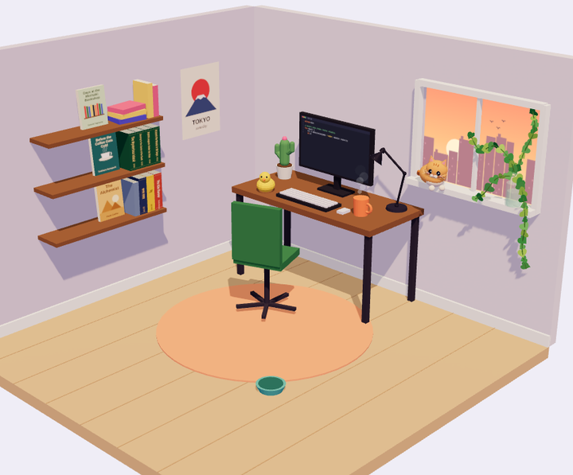
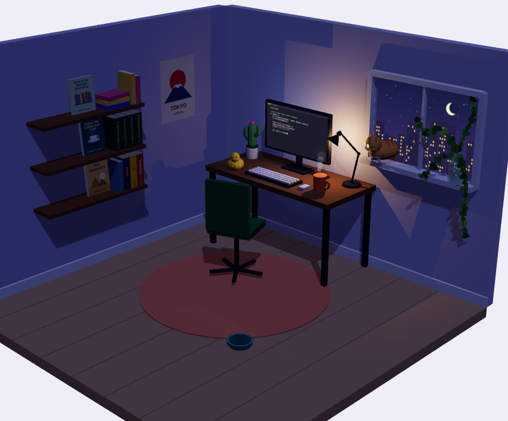
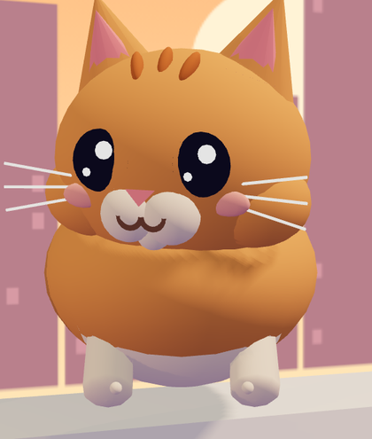

<div align="center">

# 🐱 wazedkhan.github.io

**My portfolio is a tiny 3D room. There's a desk, a lamp, a rubber duck, and a cat named Mochi who will tell you about me.**

[**Visit the desk →**](https://wazedkhan.github.io)




</div>

---

## ⭐ Before you copy this

Go ahead, borrow ideas or fork the whole thing. That's what it's here for.

All I ask in return:

1. **Leave a star** ⭐ on this repo. It costs you one click and makes my day.
2. **Keep a small credit** somewhere, like *"Desk inspired by [Wazed](https://wazedkhan.github.io)"* in your footer or README.
3. **Swap in your own story.** Your books, your projects, your cat. A portfolio only works when it's *yours*.

Mochi is watching. She knows who didn't star. 🐾

---

## Meet Mochi



Mochi is the desk cat and the real host of the site.

- **Click her** to chat. She answers questions about my work, stack, projects and how to hire me.
- **Stroke her** with your mouse to pet her. She purrs and floats little hearts.
- **Drag her** around the room. She lands on the nearest shelf, sill or desk.
- **Click the bowl** to feed her. She walks over and eats.
- **Leave her alone** and she falls asleep. Z's included.
- **Come back later** and she remembers you, and what you did last time.
- **Feed, pet and chat with her** in one visit and she gives you my CV. 🎁

Her brain is a small keyword matcher in [`cat-brain.js`](cat-brain.js) that runs fully in the browser, so there's no backend and no API bill. There's a hook (`CAT_API`) if you ever want to plug in a real LLM behind a proxy.

<br clear="right" />

## What else is on the desk

| Thing | What it does |
|---|---|
| 💡 **Lamp** | Switches the whole room between day and night |
| 🖥️ **Monitor** | Types out Go code live, and zooms you into my projects |
| 🦆 **Rubber duck** | Senior debugging consultant. Click for advice |
| 📚 **Bookshelf** | Books I'm actually reading. Each one has a quip |
| 🌵 **Cactus** | Low maintenance, high uptime |
| 🪟 **Window** | The Dhaka skyline, sunset by day and city lights by night |

Below the desk: a horizontally scrolling projects shelf, a train that rides along my career journey, and draggable stickers.

## Built with

- **[Three.js](https://threejs.org/)** for the room, all built from code (no 3D model files)
- **Plain HTML, CSS and JavaScript** (ES modules, no framework, no build step)
- **Web Audio** for Mochi's meows, purrs and crunching
- **GitHub Actions + GitHub Pages** for deploys

Everything is built in code from boxes, spheres and cylinders. The room is low-poly, Mochi is smooth-shaded so she looks soft, and the lamp's shadows only update while it's on, to keep it fast on phones.

## Run it locally

ES modules need a server, so opening `index.html` directly won't work:

```bash
git clone https://github.com/WazedKhan/wazedkhan.github.io.git
cd wazedkhan.github.io
python3 -m http.server 8000
# open http://localhost:8000
```

No `npm install`. Three.js loads from a CDN through an import map in `index.html`.

## Project layout

```
index.html        page content, import map, visitor alerts
main.js           page logic: theme, scroll effects, Mochi's chat, CV drop
scene.js          the 3D room, Mochi's body and animations, interactions
cat-brain.js      what Mochi knows and how she matches questions
mochi-memory.js   remembers returning visitors (in their browser only)
cat-sound.js      meows, purrs, footsteps
styles.css        everything visual outside the canvas
assets/           photo, sounds, CV
```

## Deploying your own

1. Fork the repo and rename it to `<your-username>.github.io`.
2. Replace my content: text in `index.html`, Mochi's facts in `cat-brain.js`, books in `scene.js`, your CV in `assets/`.
3. Push to `master`. The workflow in [`.github/workflows/deploy.yml`](.github/workflows/deploy.yml) publishes it.

**Optional visitor alerts:** add a `DISCORD_WEBHOOK_URL` secret to the repo and you'll get a Discord message when someone visits, plus a summary of what they did. Open your site once with `?me` to stop alerts from your own browser (`?me=off` to undo).

> ⚠️ The webhook URL ends up in the deployed page, so anyone could find it. Fine for a portfolio, but put it behind a small proxy (for example a Cloudflare Worker) if you care.

## Say hi

I'm Wazed, a backend-leaning full-stack engineer in Dhaka, working with Go, Python and React.
I'm open to roles in Bangladesh, remote, or abroad with visa sponsorship.

📧 [wajed.abdul.khan@gmail.com](mailto:wajed.abdul.khan@gmail.com) · 💼 [LinkedIn](https://www.linkedin.com/in/wajed-khan) · ✍️ [Medium](https://wajedkhan.medium.com/)

<div align="center">

<br />

**If Mochi made you smile, give her a ⭐**

</div>
